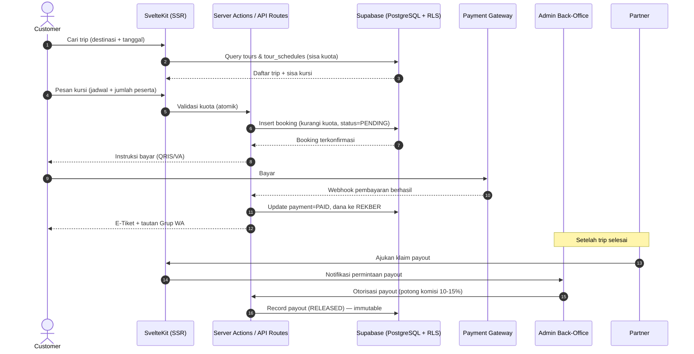
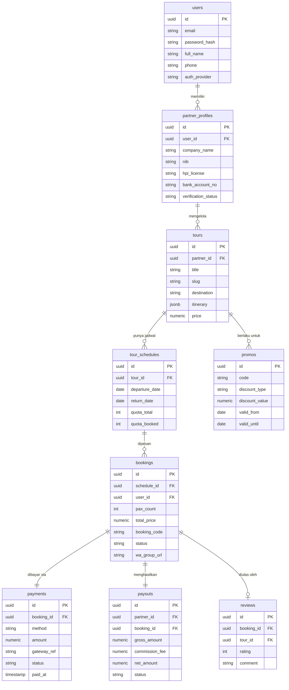

# PRD — Project Requirements Document

## 1. Overview

**Indonesia Tours** adalah platform agregator Open & Private Trip terkurasi yang membantu
pekerja kantoran di kota besar menemukan, memesan, dan membayar tiket open trip dengan aman
dan cepat — tanpa harus scroll TikTok, DM banyak operator random, atau was-was transfer ke
rekening pribadi.

**Masalah yang diselesaikan:**
- Proses mencari open trip (mis. Bromo, Labuan Bajo) masih manual: scroll hashtag,
  DM/chat WhatsApp satu per satu ke banyak operator.
- Respons operator lambat dan tidak konsisten, membuat calon peserta ragu.
- Pembayaran sering ke rekening pribadi → risiko penipuan/uang dibawa kabur.
- Kepastian keberangkatan sering baru jelas H-3, padahal biasanya baru beberapa orang ikut.

**Tujuan utama:**
- Menyediakan katalog open trip terkurasi dengan sisa kuota kursi yang **pasti dan real-time**.
- Memungkinkan pemesanan & pembayaran online (QRIS/VA) dalam satu alur, tanpa perlu chat admin.
- Menjaga keamanan dana lewat **rekening bersama (escrow)**: uang ditahan sampai trip selesai.
- Mengelola mitra/operator secara terverifikasi (NIB, lisensi HPI) melalui portal mitra & back-office.
- Memberi tiket digital, akses grup WhatsApp, dan kepastian status keberangkatan langsung di aplikasi.

**Monetisasi:** potongan komisi platform **10–15%** per transaksi tur yang tuntas.

---

## 2. Requirements

**Fungsional**
- Pengguna dapat mencari trip berdasarkan destinasi dan filter tanggal (termasuk long weekend).
- Setiap kartu trip menampilkan harga dan **sisa kursi** yang akurat dan terkunci saat booking.
- Sistem mencegah overbooking secara atomik (`kuota_terisi <= kuota_total`).
- Pembayaran online via QRIS dan Virtual Account, dengan dana ditahan platform (escrow).
- E-tiket digital + tautan grup WhatsApp otomatis setelah pembayaran sukses.
- Mitra dapat mengunggah legalitas (NIB & HPI) dan menawarkan paket + jadwal keberangkatan.
- Admin dapat memverifikasi mitra, mengotorisasi pencairan dana, dan mengekspor laporan.
- Soft delete (`IsDeleted = 1`) untuk data master; tabel finansial bersifat permanen (immutable).

**Non-fungsional**
- Aman (auth Supabase, Row Level Security, route guard SvelteKit).
- Server-Side Rendering (SvelteKit) untuk pengalaman cepat dan SEO-friendly.
- Skalabilitas multi-tenant (setiap entitas memiliki `CompanyCode`).
- Audit trail wajib: setiap tabel entitas punya 7 default fields
  (`CompanyCode`, `Status`, `IsDeleted`, `CreatedBy`, `CreatedDate`, `LastUpdatedBy`, `LastUpdatedDate`).

**Konstrain**
- Pembayaran, autentikasi, dan database memakai Supabase.
- Deployment awal di Vercel.

---

## 3. Core Features

> Struktur fitur di bawah **konsisten dengan roadmap** yang sudah disetujui, dikelompokkan per fase.

### Fase 1 — Jelajah Trip & Pesan Kursi [high]
- **Jelajah Trip**
  - Pencarian Trip: ketik destinasi (mis. Bromo, Labuan Bajo) untuk langsung melihat trip tersedia.
  - Filter Tanggal Libur: saring berdasarkan long weekend atau tanggal cuti.
  - Kartu Trip & Sisa Kursi: tampilkan daftar trip + harga + jumlah kursi tersisa.
  - Detail Paket Trip: itinerary, fasilitas, dan ulasan peserta sebelumnya.
- **Pesan Kursi**
  - Pilih Jadwal Keberangkatan.
  - Atur Jumlah Peserta (diri sendiri / bareng teman).
  - Ringkasan Biaya transparan tanpa biaya tersembunyi.
  - Konfirmasi & Kunci Kursi: kursi langsung terkunci saat pesanan dibuat (anti-overbooking).

### Fase 2 — Bayar Online & Pesanan Saya [high]
- **Bayar Online**
  - Pilih Metode Bayar (QRIS / Virtual Account).
  - Instruksi & Status Pembayaran yang jelas.
  - Uang Ditahan Aman di rekber sampai trip selesai.
  - Batas Waktu & Pengingat bayar.
- **Pesanan & Tiket Saya**
  - E-Tiket Digital.
  - Akses Grup WhatsApp peserta.
  - Status Keberangkatan (jadi berangkat / tidak).
  - Batal & Refund dengan alur yang transparan.

### Fase 3 — Akun, Portal Mitra & Back-Office [medium]
- **Masuk & Akun**
  - Daftar Akun, Masuk Email & Google, Lupa Sandi, serta Profil & Data Pemesan.
- **Portal Mitra**
  - Verifikasi Legalitas (NIB & HPI).
  - Kelola Paket & Jadwal.
  - Atur Kuota Kursi per jadwal.
  - Klaim Pencairan Dana setelah trip selesai.
- **Back-Office Admin**
  - Dashboard Metrik (pesanan, mitra, nilai transaksi).
  - Verifikasi & Kurasi Mitra.
  - Otorisasi Pencairan Dana ke mitra.
  - Laporan & Ekspor (penjualan & komisi).

### Fase 4 — Promo & Diskon [low]
- Kode Promo & Voucher.
- Diskon Early Bird.
- Poin & Ajak Teman.
- Notifikasi Promo.

---

## 4. User Flow

**A. Customer — Alur Utama (First Win: temukan & amankan kursi dengan aman)**
1. Buka aplikasi → langsung masuk ke halaman **Jelajah Trip**.
2. Ketik destinasi (mis. "Bromo") atau pilih **Filter Tanggal Libur**.
3. Lihat **Kartu Trip + sisa kursi** → buka **Detail Paket Trip**.
4. Klik **Pesan Kursi** → pilih jadwal, atur jumlah peserta → lihat **Ringkasan Biaya**.
5. **Konfirmasi & Kunci Kursi** → kursi langsung ter-hold (kuota berkurang atomik).
6. Pilih metode bayar (QRIS/VA) → ikuti instruksi → status pembayaran ter-update.
7. Dana masuk ke **rekber** (ditahan platform).
8. Terima **E-Tiket + tautan Grup WhatsApp** di halaman **Pesanan Saya**.
9. Pantau **Status Keberangkatan**; bila tidak jadi, refund otomatis diproses.
10. Setelah trip tuntas, **mitra menggajukan klaim payout** dan admin mengotorisasi pelepasan dana
    (dipotong komisi 10–15%).

**B. Mitra (Partner)**
1. Registrasi → unggah NIB & lisensi HPI.
2. Tunggu verifikasi admin → status mitra aktif.
3. Tambah paket trip → atur jadwal & kuota per jadwal.
4. Lihat pesanan masuk & dananya di rekber.
5. Setelah trip selesai → ajukan **Klaim Pencairan Dana**.

**C. Admin (Back-Office)**
1. Login → buka **Dashboard Metrik**.
2. **Verifikasi & Kurasi Mitra** (approve/reject).
3. CRUD katalog & kurasi paket tayang.
4. **Otorisasi Pencairan Dana** mitra setelah trip tuntas.
5. Ekspor **Laporan** penjualan & komisi.

---

## 5. Architecture

**Gambaran sistem:**
- **Frontend**: SvelteKit (SSR) + TypeScript + Tailwind CSS + shadcn-svelte.
- **Backend/DB**: Supabase (PostgreSQL + Auth + Realtime) dengan **Drizzle ORM**.
- **Integrasi**: Payment Gateway (QRIS/VA) → dana masuk rekber.
- **Keamanan**: Supabase Auth (Email & Google), Row Level Security (RLS) PostgreSQL,
  route guard SvelteKit.
- **Deployment**: Vercel (frontend) + Supabase (managed DB).

---

## 6. Database Schema

Setiap tabel entitas menerapkan **7 default fields**:
`CompanyCode (VARCHAR32, PK)`, `Status (TINYINT: 1=Aktif, 0=Nonaktif, 2=Draft/Pending)`,
`IsDeleted (TINYINT, default 0)`, `CreatedBy`, `CreatedDate`, `LastUpdatedBy`, `LastUpdatedDate`.
Slug memakai **Partial Unique Index** (`WHERE IsDeleted = 0`). Tabel finansial (payments, payouts) bersifat **immutable**.

**Tabel utama & kolom kunci:**
- **users**: `id (uuid PK)`, `email`, `password_hash (nullable jika Google)`, `full_name`, `phone`, `auth_provider`.
- **partner_profiles**: `id (uuid PK)`, `user_id (FK users)`, `company_name`, `nib`, `hpi_license`, `bank_name`, `bank_account_no`, `bank_account_name`, `verification_status`.
- **tours**: `id (uuid PK)`, `partner_id (FK partner_profiles)`, `title`, `slug`, `destination`, `description`, `itinerary (jsonb)`, `facilities (jsonb)`, `price`, `cover_image_url`.
- **tour_schedules**: `id (uuid PK)`, `tour_id (FK tours)`, `departure_date`, `return_date`, `quota_total (int)`, `quota_booked (int)`, `status`.
- **bookings**: `id (uuid PK)`, `schedule_id (FK tour_schedules)`, `user_id (FK users)`, `pax_count`, `total_price`, `booking_code`, `status (PENDING/PAID/CANCELLED/COMPLETED)`, `wa_group_url`.
- **payments**: `id (uuid PK)`, `booking_id (FK bookings, 1:1)`, `method (QRIS/VA)`, `amount`, `gateway_ref`, `status`, `paid_at`, `expired_at`.
- **payouts**: `id (uuid PK)`, `partner_id (FK partner_profiles)`, `booking_id (FK bookings, 1:1)`, `gross_amount`, `commission_fee`, `net_amount`, `status (REQUESTED/AUTHORIZED/RELEASED)`, `released_at`.
- **reviews**: `id (uuid PK)`, `booking_id (FK bookings)`, `tour_id (FK tours)`, `rating (int)`, `comment`, `created_at`.
- **promos** *(Fase 4)*: `id (uuid PK)`, `code`, `discount_type`, `discount_value`, `valid_from`, `valid_until`, `quota`.

---

## 7. Tech Stack

> Sesuai stack yang ditetapkan user pada input (TIDAK memakai default Next.js).

- **Frontend:** SvelteKit + TypeScript + Tailwind CSS + shadcn-svelte.
- **Backend & Auth:** Supabase (Auth: Email/Password + Google OAuth).
- **Database:** Supabase PostgreSQL + **Drizzle ORM** + Row Level Security (RLS).
- **Pembayaran:** Payment Gateway lokal (QRIS & Virtual Account) dengan webhook ke server.
- **Realtime:** Supabase Realtime (untuk status pembayaran & sisa kuota).
- **Deployment:** Vercel (frontend + server actions) dan Supabase (managed DB).
- **Tooling:** Docker untuk environment lokal, ESLint + Prettier untuk konsistensi kode.